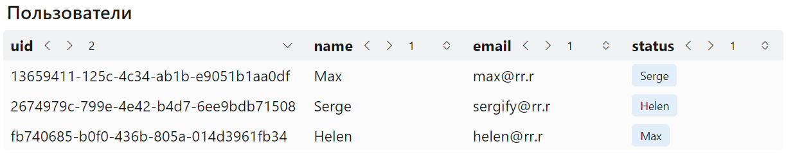

## Svelte TABLE

Sveltekit компонент таблицы с оформлением на **Bootstrap 6**.



Добавьте `<Table />` на свою страницу.

У компонента есть параметры:

- `title` - заголовок таблицы (опционально),
- `data` - данные, передаваемые в таблицу в формате массива объектов, например:

  ```json
  let data = [{
  	uid: 1,
  	name: 'Serge',
  	email: 'sergify@rr.r',
  	status: 'ok'
  },
  {
  	uid: 2,
  	name: 'Helen',
  	email: 'helen@rr.r',
  	status: 'go'
  }]
  ```

  , с нужным вам количеством полей,

- `titles` - заголовки колонок таблицы (опционально), если не указывать, то значения берутся из ключей объектов **data**,
- `grows` - массив **grow** значений (опционально), для задания каждой колонке доли ширины в таблице, например:

  `[2,1,1,1]`,
  если не указывать, то значения устанавливаются равными единице,

-`_class` и `_style` - для задания классов и стилей оформления в формате:

```ts
{ table?: string; header?: string; row?: string }
```

, где `table`, `header`, `row` оформляют всю таблицу, заголовки столбцов или строки таблицы соответственно.
